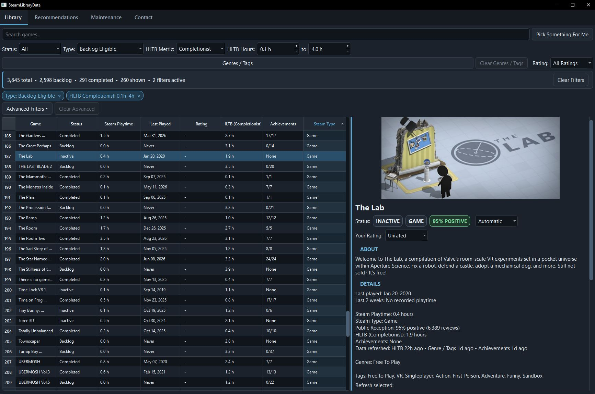

# SteamLibraryData



SteamLibraryData is a desktop Steam library and backlog manager for organizing large game libraries, tracking play activity, enriching games with external metadata, and generating personalized recommendations.

It combines Steam library data with SteamSpy metadata, HowLongToBeat estimates, achievement progress, personal ratings, and local recommendation modeling in a single desktop application.

All primary library and recommendation data is stored locally.

## Features

### Library Management

- Import an owned Steam library through the Steam Web API
- Track lifetime playtime, recent playtime, and last-played dates
- Search, sort, and filter large libraries
- Track automatic and manual backlog statuses
- Add persistent 1 to 5 star enjoyment ratings
- Pick a random game from the currently filtered library
- View game artwork, descriptions, store links, and metadata
- Play Steam trailers directly in the application
- Refresh individual game data when needed

Library filters include:

- backlog status
- Steam application type
- game and software genres
- SteamSpy tags
- playtime
- HowLongToBeat estimates
- achievement progress
- last-played activity
- data completeness

Steam entries are classified as games, software, DLC, video, hardware, or unknown. The application also identifies likely Test/Beta entries and can distinguish unknown games from unknown software when enough metadata is available.

### HowLongToBeat

SteamLibraryData can retrieve:

- Main Story
- Main + Extra
- Completionist
- All Styles

The HLTB integration includes conservative automatic matching, alternate title handling, Steam App ID verification, stored match information, and a manual review workflow for ambiguous results.

Uncertain matches can be reviewed before being accepted instead of forcing an unreliable automatic match.

### Achievements

Steam achievement data is used to show:

- total achievements
- unlocked achievements
- completion percentage
- completion status

Achievement data can also be refreshed when Steam playtime changes after the previous check.

### Personalized Recommendations

SteamLibraryData includes a local recommendation system built from the user's own library and feedback.

The model uses:

- Steam genres
- weighted SteamSpy tags
- personal ratings
- manual game status
- playtime
- HLTB completion estimates
- achievement progress
- content similarity
- positive-neighbor matching
- learned preference profiles
- K-Means taste clustering

The **For You** view recommends unplayed games already present in the user's Steam library and explains why each game was selected.

The **Similar to a Game** view provides content-based similarity search across the library.

Recommendation generation is local and does not upload the user's preference profile to an external recommendation service.

## Maintenance

The Maintenance tab provides centralized data-management tools for:

- Steam library refresh
- Steam application classification
- missing metadata
- HowLongToBeat data
- achievement data
- stale-data refreshes
- HLTB review
- image-cache management
- Steam account configuration
- API-key management
- database reset

Long-running network operations run in background workers so the interface remains responsive.

Updates support progress reporting, cancellation, and failure inspection.

## Steam Web API Setup

SteamLibraryData uses the official Steam Web API for owned-library and account-specific Steam data.

The application does **not** include or distribute a Steam Web API key. Each user must provide their own.

### Requirements

You will need:

- your SteamID64
- your personal Steam Web API key
- appropriate Steam profile and library visibility for the information you want to retrieve

A standard Steam Web API key can be registered at:

https://steamcommunity.com/dev/apikey

SteamLibraryData does not require your Steam password, Steam Guard information, or a Steamworks publisher key.

### First Launch

On first launch, the application asks for your Steam Web API key and Steam account information.

The API key is stored through the operating system credential manager rather than in the SQLite database or `settings.json`.

Your SteamID64 and API key can later be changed from the application.

Changing to a different Steam account requires resetting the account-specific local database so data from multiple accounts is not mixed.

Treat your Steam Web API key as a private credential. Do not include it in screenshots, bug reports, or repository files.

## Local Data and Privacy

Application data is stored outside the program directory in the operating system's normal user-data location.

- **Windows:** `%APPDATA%\SteamLibraryData`
- **macOS:** `~/Library/Application Support/SteamLibraryData`
- **Linux:** `$XDG_DATA_HOME/SteamLibraryData` or `~/.local/share/SteamLibraryData`

This includes:

- the SQLite database
- application settings
- cached game artwork

The Steam Web API key is stored separately through the operating system credential manager.

The local database is associated with one Steam account to help prevent accidental mixing of data between accounts.

## Distribution

The current packaged release target is Windows.

SteamLibraryData has been successfully built as:

- a standalone distribution-folder build
- a portable one-file executable

The packaged application includes the required Qt components and Qt Multimedia support used for Steam trailer playback.

The current release format is portable. A traditional Windows installer is not currently required.

## Technology

- **Python**
- **PySide6 / Qt**
  - `QTableView`
  - `QAbstractTableModel`
  - Qt layouts and splitters
  - Qt Multimedia
- **SQLite**
- **requests**
- **keyring**
- **howlongtobeatpy**
- **Steam Web API**
- **SteamSpy**
- **Steam Store data**
- **Nuitka** for Windows packaging

## Data Sources

### Steam Web API

Used for:

- owned games
- Steam App IDs
- game names
- lifetime playtime
- recent two-week playtime
- last-played timestamps
- achievements
- Steam application classification

Documentation:

https://partner.steamgames.com/doc/webapi_overview

https://partner.steamgames.com/doc/webapi

### Steam Store

Used for:

- artwork
- store links
- descriptions
- trailer metadata and playback

Trailer information is requested only when needed.

### SteamSpy

Used for:

- genres
- weighted tags
- positive and negative reception data

https://steamspy.com/about

### HowLongToBeat

Used for:

- Main Story estimates
- Main + Extra estimates
- Completionist estimates
- All Styles estimates
- title matching
- match review

SteamLibraryData uses `howlongtobeatpy` as part of its HLTB integration.

https://pypi.org/project/howlongtobeatpy/

## Testing and Diagnostics

The project includes automated regression tests for core application behavior, including:

- recommendation calculations
- feedback modeling
- classification and backlog eligibility
- database persistence
- Steam API parsing
- update workflows
- important UI regressions

The project also includes diagnostic utilities:

```text
tools/
├── database_audit.py
├── recommendation_audit.py
├── recommendation_evaluation.py
└── recommendation_inspect.py
```

These tools are used to inspect the real local database, validate recommendation output, evaluate recommendation quality, and diagnose recommendation behavior.

A typical validation pass is:

```powershell
python -m compileall .
pytest
python tools/database_audit.py
python tools/recommendation_audit.py
```

## Project Progress

Development has been organized into several major phases.

### Phase 1: Data Collection and First GUI

Established Steam library importing, SteamSpy metadata, HowLongToBeat estimates, achievements, SQLite persistence, filtering, and the first usable interface.

[Read the Phase 1 progress notes](progress/01-Assembling-the-GUI/README.MD)

### Phase 2: Expansion

Expanded the application architecture and added artwork, image caching, account ownership, settings, first-run setup, and safer library refreshing.

[Read the Phase 2 progress notes](progress/02-Expansion/README.MD)

### Phase 2.5: Status, Activity, and Media

Added recent activity, last-played dates, backlog statuses, richer game details, store access, trailer playback, and the migration from `QTableWidget` to a model-backed `QTableView`.

[Read the Phase 2.5 progress notes](progress/02.5-Status-Activity-and-Media/README.MD)

### Phase 3: External Data Infrastructure

Moved external-data operations into background workers and added progress reporting, cancellation, stronger failure handling, persistent HLTB review, and Steam application classification.

[Read the Phase 3 progress notes](progress/03-External-Data-Infrastructure/README.MD)

### Phase 4: User Configuration and Application Hardening

Moved application data into OS user-data directories, replaced development-only configuration with in-app setup, added secure credential storage, improved account handling, and hardened external-service failures.

[Read the Phase 4 progress notes](progress/04-User-Config/README.MD)

### Phase 5: ML Recommendations

Added personalized local recommendations, ratings, preference modeling, positive-neighbor matching, K-Means taste clustering, recommendation explanations, Similar to a Game search, evaluation tools, and recommendation audits.

[Read the Phase 5 progress notes](progress/05-ML-Recommendations/README.MD)

### Phase 6: UI and Distribution

Focused on release preparation and application polish.

Major work included:

- UI and layout refinement
- responsive Library and Recommendation details
- improved Maintenance presentation
- light, dark, and system appearance support
- centralized classification and backlog eligibility
- stale-data refresh workflows
- expanded regression testing
- consolidated diagnostic tools
- dead-code and legacy cleanup
- Windows standalone packaging
- one-file executable generation
- packaged application smoke testing

[Read the Phase 6 progress notes](progress/06-UI-and-Distribution/README.MD)

## Current Status

The primary planned application architecture and feature set are complete.

Current work is focused on release validation, packaging, documentation, bug fixes, and smaller quality-of-life improvements.

Potential future work may include:

- installer-based Windows distribution
- code signing
- macOS packaging and validation
- additional backlog-management tools
- saved or external guide links
- further recommendation and UI refinements